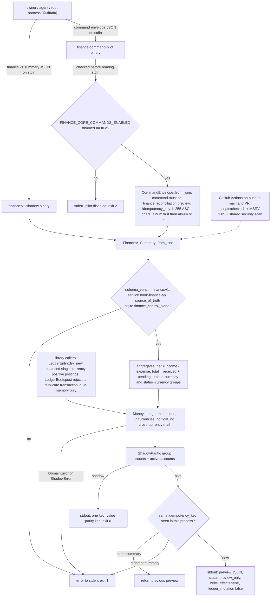
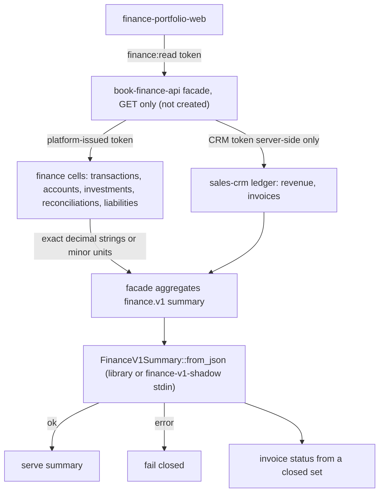

# 01 — Business process (As-Is / To-Be)

finance-ledger-core (crate `book-finance-core`) คือ kernel ภาษา Rust ที่บังคับกฎจำนวนเงินและบัญชีคู่ (double-entry) แบบ pure: ไม่มี DB ไม่มีเครือข่าย ไม่มี credential และไม่ได้ deploy ผู้ใช้คือ owner และ agent ที่สร้าง Finance Platform ผ่าน library และ binary สองตัวที่อ่าน JSON จาก stdin

Last reviewed: 2026-11-27 · commit `9660470`

## As-Is (จากโค้ดวันนี้)

Sources: `src/bin/finance-v1-shadow.rs`, `src/bin/finance-command-pilot.rs`, `src/command.rs` (`CommandEnvelope::from_json`, `CommandExecutor::execute`, `feature_flag_enabled`), `src/shadow.rs` (`FinanceV1Summary::from_json`, `parity`), `src/lib.rs` (`Money`, `LedgerEntry`, `LedgerBook`), `scripts/check.sh`, `.github/workflows/ci.yml`, `README.md`

ข้อเท็จจริงจากโค้ด:

- idempotency ของ pilot อยู่ใน `HashMap` ในหน่วยความจำเท่านั้น: หายเมื่อ process จบ และไม่มีการเขียน ledger หรือ record ใด ๆ
- `tests/kernel_purity_test.rs` ทำให้ CI ล้มถ้า kernel ได้ dependency ด้าน network, HTTP, DB, auth, env หรือ filesystem
- README อ้าง harness `task test:finance-shadow` และ `task test:finance-command` ใน "root repository" แต่ไม่พบ task ชื่อนี้ใน `bookchaowalit-empire` หรือ `platform-ops-cli` วันนี้ **[ต้องยืนยัน]** (root เดิมคือ solo-empire ที่ archive แล้ว)
- ไม่มี endpoint ใดใน repo นี้; `GET /api/finance/v1[/*]` ของ server เก่าตอบ `410 Gone` ตามบันทึกใน `docs/gates/BOO-140-finance-api-boundary.md`

## To-Be (docs/gates/BOO-140-finance-api-boundary.md: owner decision PROPOSED, NOT ACCEPTED; docs/UPGRADE-PLAN.md)

Sources: `docs/gates/BOO-140-finance-api-boundary.md` §Owner decision, §Gaps; `docs/UPGRADE-PLAN.md` §Backlog

## Gap

| ID | As-Is → To-Be | Status | Owner | Evidence |
|---|---|---|---|---|
| G1 | ข้อเสนอ facade `book-finance-api` ยังไม่ได้รับการตัดสิน และ contract `bookfinance-api-v1` ถูก mark retired → owner รับหรือปฏิเสธข้อ 1–6 ของ BOO-140 | decide | owner | `docs/gates/BOO-140-finance-api-boundary.md` §Owner decision, §Gaps 9 |
| G2 | ไม่มีใครเสิร์ฟ `/api/finance/v1` (archive ตอบ 410, `book-finance-api` not-created) → facade อ่านอย่างเดียวที่ใช้ kernel ตรวจ summary ก่อนเสิร์ฟ | blocked | owner | BOO-140 §Gaps 1; รอ G1 |
| G3 | `InvoiceAggregate.status` รับ string ใดก็ได้ที่ไม่ว่าง → ชุดสถานะปิด | blocked | claude | `docs/UPGRADE-PLAN.md` §P1 (รอรายการสถานะจาก owner ของ Finance API) |
| G4 | ค่าคงที่ `FINANCE_V1_SOURCE_OF_TRUTH = sqlite.finance_control_plane` ชี้ storage ที่เลิกใช้ → contract เวอร์ชันใหม่ (`finance.v1.1` หรือ `finance.v2`) พร้อมช่วง compatibility | decide | owner | `src/shadow.rs:7`; BOO-140 §Gaps 4, §Owner decision 4 |
| G5 | cell เก็บจำนวนเงินเป็น `real` (float) ซึ่ง kernel อาจปฏิเสธหรือปัดเศษ → ส่งข้ามขอบเป็น decimal string หรือ minor units | decide | owner | BOO-140 §Gaps 3, §Owner decision 3 |
| G6 | auth สามแบบไม่ตรงกัน (hashed `finance:read`, platform JWT, CRM static token) → ออกแบบ delegation ก่อนเขียน facade | decide | owner | BOO-140 §Gaps 2, §Owner decision 5 |
| G7 | root harness ของ shadow parity ยังไม่ตรวจ response จริงกับ JSON Schema และไม่พบ task นี้ใน root ปัจจุบัน → harness ตรวจ schema ด้วย | todo | claude | `docs/UPGRADE-PLAN.md` §P2; README §Verification [ต้องยืนยัน] |
| G8 | ไม่มี `cargo deny` / `cargo audit` → เพิ่ม job เมื่อ dependency โตขึ้น | todo | claude | `docs/UPGRADE-PLAN.md` §P2 |

## Open questions

- harness `task test:finance-shadow` / `task test:finance-command` อยู่ repo ไหนหลัง solo-empire ถูก archive หรือถูกเลิกไปแล้ว
- ถ้า owner ปฏิเสธ BOO-140 kernel นี้จะคงเป็น showcase ถาวร (DOCPACK verdict `showcase`) หรือไม่
